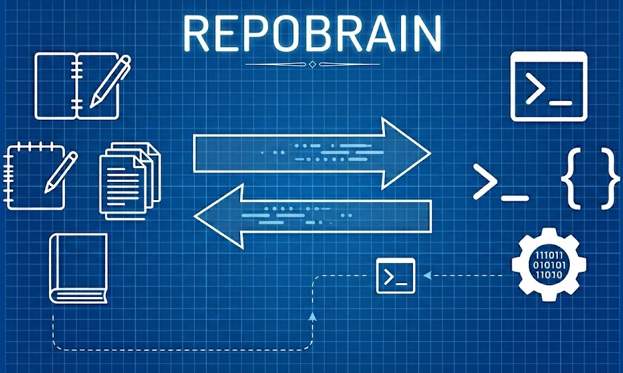

# RepoBrain Skill Blueprint



Blueprint version: `2026.11.25`

[Version History](#version-history) lists the changes from `2026.05.06`.

This repository is a blueprint for creating project-specific documentation skills.

It is not a skill package to install as-is. A coding agent should read this repository, inspect the destination repository, and then generate skills that fit the destination repository's own structure, instructions, documentation model, and workflow.

## Copy/Paste Prompt For Human Users

Use this prompt when you want to point another agent at this blueprint. It is intentionally short and delegates the detailed procedure to this repository itself.

```text
Use https://github.com/jaltez/repobrain-skill-blueprint as the blueprint source.
Read that repository and follow its porting instructions.
Then inspect my repository, compare it against the blueprint, and give me a concise skill-port proposal: what to reuse, what to add, the local bindings and evidence strategy you would use, any blockers you found, and which files you would generate.
Do not generate anything until inspection is complete.
```

## What This Blueprint Produces

Default output: two separate skills in the destination repository.

- An orientation skill for reading intent-focused documentation before editing code or making claims about behavior.
- A maintenance skill for re-verifying and refreshing intent-focused documentation after code changes.

Secondary option: one combined multi-capability skill.

Use the combined option only when the destination repository has strong reasons to minimize skill files or when its skill system routes poorly across multiple artifacts. The default recommendation is still two skills because the pre-change and post-change workflows have different triggers, inputs, and safeguards.

Combined mode is a secondary adaptation path, not a first-class default in this blueprint. The repository provides split templates only. If a destination repository truly needs one combined artifact, treat that merge as a local design task and preserve separate internal branches explicitly.

## Important Disclaimer For Porting Agents

This blueprint cannot choose the final integration details for the destination repository.

Before generating anything, the porting agent must inspect the destination repository and decide:

- where skills should live
- what the local skill names should be
- which instruction files, memory systems, or agent policies already exist
- whether those existing systems should be reused, extended, avoided, or unified
- whether the destination repository already has an intent-doc system or needs one first
- how git diff scope should be determined in that repository
- whether the destination repository's prompt patterns require narrower wording or stronger guardrails
- which runtimes must load the skills, and which skill directories each one scans
- which front matter fields each runtime accepts or rejects

If the destination repository already has a memory mechanism, repository instructions, or agent-specific metadata, do not blindly add a second competing system. Reuse or unify the existing mechanism when possible. If coexistence is necessary, document the boundary clearly.

If the destination repository's git configuration, branch model, or remote tracking is unusual, the maintenance skill must adapt its diff-base procedure accordingly instead of assuming `@{upstream}` will work.

## Stop Immediately If

Do not continue porting until these conditions are resolved:

- maintainers explicitly do not want intent-focused docs
- no architecture overview or system map exists and you cannot establish stable boundaries yet
- existing skills, memory, or instruction systems overlap and you have not resolved reuse versus coexistence
- the destination runtime format constraints are unknown and you cannot determine a compatible skill schema
- the maintenance workflow has no reliable evidence source such as git history, a changed-file list, a patch excerpt, a review artifact, or an explicit component set

## Recommended Repository Flow For The Porting Agent

Treat this repository as a decision framework, not as a copy-paste package.

Use [docs/porting-checklist.md](docs/porting-checklist.md) as the authoritative step-by-step procedure. The README summarizes the same flow and the main constraints.

### 1. Inspect The Destination Repository First

Read the repository-wide instructions, architecture overview, existing documentation conventions, and any agent memory or instruction files that might overlap with the new skills.

If no repository-wide rules source exists, record that absence explicitly and continue with the architecture overview, local docs, and code conventions. Do not invent a new rules file unless the destination maintainers actually want one.

Decide whether the destination repository already has:

- a global rules document
- an architecture overview
- intent-focused component or service docs
- a canonical doc template
- a stable source tree, config tree, and shared-code area
- an existing skill system that should be extended instead of replaced

Inspection is complete only when you have identified, or explicitly confirmed absent, at least the following:

- repository-wide rules source
- architecture overview or system map
- intent-doc root or the absence of one
- current documentation state and first-pass plan: reuse, normalize, or bootstrap
- source root, shared-code root, and config root when relevant
- existing skills, memory files, or instruction files that may overlap
- the maintenance evidence source the destination repository can actually support
- the destination skill runtime's schema constraints
- skill location and front matter rules for each runtime that loads the skills

Record these findings before you adapt templates. A port without this record is incomplete.

### 1A. Establish The Documentation Baseline First

Do not generate the maintenance skill until the destination repository has a usable documentation baseline.

After inspection, choose the lightest viable first-pass path:

- reuse: existing docs already provide a stable target for the skills
- normalize: existing docs are useful but need a first pass into a clearer or more consistent shape
- bootstrap: no usable documentation baseline exists yet, so create the smallest one from scratch

If the choice is not obvious, use [docs/decision-guides.md](docs/decision-guides.md). It provides a compact matrix for choosing between reuse, normalize, and bootstrap.

Create or normalize the smallest viable documentation target before porting the full pair of skills:

- a lightweight architecture overview or system map
- one stable intent-doc root or local equivalent
- one canonical component or service doc template, or one canonical normalization target for existing docs
- one or two seed docs, or one or two normalized existing docs, for the areas most likely to need orientation first

If you need a starting point for that documentation shape, adapt [templates/intent-doc-template-sketch.md](templates/intent-doc-template-sketch.md) into the destination repository's own conventions instead of improvising from scratch.

Recommended order:

- inspect the current documentation state
- choose reuse, normalize, or bootstrap
- create or normalize the smallest viable documentation baseline
- port the orientation skill
- validate that the orientation skill can use the new docs productively
- port the maintenance skill only after the documentation target is stable enough to review and refresh consistently

If the destination repository explicitly does not want an intent-doc system, stop and do not use this blueprint.

### 2. Choose The Generated Skill Layout

Default decision: generate two separate skills.

- Choose an orientation skill when the goal is to understand documented intent before editing code.
- Choose a maintenance skill when the goal is to refresh documented intent after a diff.

Only choose a combined skill when the destination repository's skill runtime or conventions make multiple skills actively worse.

If you choose the combined path, treat it as an advanced local adaptation. This blueprint intentionally does not provide a combined template, so you must preserve explicit branches for orientation, maintenance, diff-base selection, and documentation action selection yourself.

### 3. Bind Local Placeholders

Map this blueprint's abstract placeholders to the destination repository's local equivalents.

Typical placeholder categories:

- repository-wide instructions
- architecture overview
- intent-doc root
- source root
- config root
- shared-code root
- local doc template
- entrypoint search patterns
- registration search patterns
- config-access search patterns
- shared-dependency search patterns
- diff-base fallback branch
- skill directory location
- skill directory name for each generated skill, identical to its `name` field

Do not keep placeholder values implicit. Record the chosen bindings in a local note, repository memory, or integration comment so later agents can reconstruct the port.

Every literal placeholder marker such as `<LOCAL_ORIENTATION_SKILL_NAME>` must be replaced or intentionally removed before finalizing a generated skill. Leftover `<...>` markers mean the port is incomplete.

### 3A. Choose The Maintenance Evidence Source

The maintenance skill should not depend on live git history alone.

Choose the change-evidence strategy the destination repository can actually support. Preferred order:

- an explicit user-supplied diff range, pull request target, or review target
- a git-based branch diff or merge-base strategy
- an explicit changed-file list or changed-component list
- a patch excerpt, review artifact, or CI-produced diff text
- a manually curated component list as a last resort

When the maintenance review reaches the documentation-action decision, use the smallest-correct-action matrix in [docs/decision-guides.md](docs/decision-guides.md) to keep `content update`, `verification-only refresh`, `no change`, and `new doc` decisions consistent.

Require the generated maintenance skill to state which evidence source it used and what blind spots remain when the evidence is incomplete.

### 3B. Keep The Generated Skills Within The Skill Format Baseline

The templates follow the Agent Skills specification. Keep each generated skill within it so that every runtime can load it.

- Put each skill in its own directory with a `SKILL.md` file. The file holds YAML front matter and then Markdown instructions.
- Keep the front matter to `name` and `description`, the only required fields. The specification also allows `license`, `compatibility`, `metadata`, and `allowed-tools`.
- Set `name` to the skill directory name. Use at most 64 lowercase letters, digits, and hyphens.
- Keep `description` under 1024 characters and in quotes. State what the skill does and when to use it. Put the main use case first.
- Treat any other field as a runtime extension. Add one only when the destination runtime documents it, and record it in the port note. A spec validator checks a skill against the specification and rejects unknown fields.
- Keep the body under 500 lines and under 5,000 tokens. Move longer reference material to files next to `SKILL.md`.

The specification does not define where skills live. Each runtime scans its own directories, and some also scan `.agents/skills/`. Choose a directory that every runtime involved is documented to scan.

### 4. Adapt The Templates

Use the files under `templates/` as the base artifacts.

While adapting them:

- rename sections if the destination skill system expects different headings
- keep the front matter to the standard fields, unless the destination runtime expects a different schema
- add a runtime extension field only when the destination runtime documents it
- keep the decision boundaries and verification discipline intact
- replace every literal placeholder marker before finalizing the generated skill
- replace generic examples with destination-relevant examples only after inspecting the destination repository
- prefer stable local search categories and live discovery at invocation time when the runtime allows it instead of freezing brittle patterns
- keep the skills intent-focused rather than turning them into file inventories

### 5. Validate The Result In The Destination Repository

Check the format first. Run the destination runtime's validator. If it has none, run a spec validator.

Run at least one real prompt for each generated skill.

If the current environment cannot execute a real prompt loop, say so explicitly and treat validation as incomplete rather than claiming full success.

The orientation skill should prove that it can load the right docs, reconcile them with code, and point to concrete next code locations.

The maintenance skill should prove that it can determine diff scope, map code changes to documented components, choose the smallest correct documentation action, and avoid unnecessary rewrites.

Then run one near-miss prompt per skill. A near-miss prompt belongs to the other skill or to no skill. Confirm that it does not trigger this one.

Validation should fail if any of the following remain true:

- any literal `<...>` placeholder marker remains in a generated artifact
- the destination-specific bindings are still implicit or not discoverable from the generated result or repository note
- the orientation skill cannot name concrete next code locations
- the maintenance skill does not state the evidence source it used and any blind spots when evidence is partial
- the generated skill format does not match the destination runtime's accepted schema
- the format check fails, for example because `name` differs from the skill directory
- a skill triggers on a near-miss prompt

## Generic Usage Shapes

Use these only as prompt patterns. Replace the nouns with the destination repository's own terminology.

- `Orient me in this feature area before I edit code.`
- `Use the local intent docs and current code to explain how this component works.`
- `Compare the current documentation for this area with the implementation and tell me if it drifted.`
- `Refresh the intent docs affected by the current branch.`
- `Trace which documented components are affected by this shared configuration change.`
- `Given this changed file list, tell me which documented areas need review.`
- `Review this patch excerpt and decide which docs need updates.`

## Required Porting Warnings

The destination repository may require additional integration work if any of the following are true:

- it already has agent memory, repository memory, or instruction files that overlap with these skills
- it has no intent-doc system yet
- it has no architecture overview and no stable component boundaries
- it is a monorepo with overlapping source roots
- it uses dynamic registration, reflection, or indirect dependency wiring that weakens code-search reliability
- it uses a git workflow where upstream tracking is absent, misleading, or routinely rewritten
- it runs in environments where only changed-file lists, patch excerpts, or review artifacts are available
- more than one runtime loads its skills, and they differ in skill directories or front matter rules

Review [docs/integration-warnings.md](docs/integration-warnings.md) before finalizing a port.

## Source-Version Traceability

Every generated skill should record which version of this blueprint was used.

Minimum recommendation:

- record the blueprint version `2026.11.25`
- record the source repository name or URL used during porting
- record the git ref, tag, or commit used during porting when available
- record the date the destination-repository port was created or re-verified

If the destination skill system allows comments or metadata blocks, add a small source marker near the top of each generated skill. If it does not, store the same information in a local repository note that future agents can discover.

Suggested marker:

```text
Ported from RepoBrain Skill Blueprint
Blueprint version: 2026.11.25
Blueprint source ref: <tag-or-commit>
Ported on: <YYYY-MM-DD>
```

## Version History

### 2026.11.25

- Both templates and both example skills now limit the front matter to `name` and `description`. Earlier versions added `argument-hint`, which the Agent Skills specification does not allow. The reference validator rejected the example skills that carried it.
- Step 3B states the skill format baseline. The checklist adds a location check for repositories with more than one runtime, a format check, and a near-miss trigger check.
- The example port now places its skills in `.agents/skills/`. Its orientation skill lists all four bound search cues, and its port dates now match.
- To refresh a port made from an earlier version, remove any non-standard front matter field unless the destination runtime documents it. Then run the format check in step 5.

### 2026.05.06

- Earlier version. Its templates put `name`, `description`, and `argument-hint` in the front matter.

## Repository Layout

- `README.md`: primary procedure for porting agents and human maintainers
- `templates/orientation-skill-template.md`: base template for the pre-change orientation skill
- `templates/maintenance-skill-template.md`: base template for the post-change maintenance skill
- `templates/intent-doc-template-sketch.md`: minimal bootstrap sketch for the destination repository's first intent doc template
- `docs/design-rationale.md`: decision boundaries, naming guidance, invariants, and split-vs-single-skill rationale
- `docs/decision-guides.md`: tie-break matrices for documentation-baseline choice and the smallest correct maintenance action
- `docs/porting-checklist.md`: destination-repository checklist and validation steps
- `docs/integration-warnings.md`: edge cases and mitigation guidance
- `examples/anonymized-service-platform/README.md`: end-to-end example port with placeholder bindings and final artifact map
- `examples/anonymized-service-platform/generated/`: illustrative generated skills, seed intent docs, and a port note for the worked example

## Suggested Naming Direction

Use naming that explains the job rather than the origin of the template.

Recommended vocabulary:

- `orientation` for the read-before-edit skill
- `maintenance` or `refresh` for the post-change update skill
- `blueprint` for this repository
- `template` for the files under `templates/`

Do not force these exact names if the destination repository already has a stronger local naming convention.

The name must also be a valid skill directory name. See step 3B.

## Start Here

1. Read this README fully.
2. Read [docs/design-rationale.md](docs/design-rationale.md).
3. Use [docs/porting-checklist.md](docs/porting-checklist.md) while inspecting the destination repository.
4. Read [docs/decision-guides.md](docs/decision-guides.md) when baseline choice or maintenance action selection is a close call.
5. Read [examples/anonymized-service-platform/README.md](examples/anonymized-service-platform/README.md) and the generated example artifacts if you want a worked example before adapting the templates.
6. Adapt one or both files in `templates/`.
7. Review [docs/integration-warnings.md](docs/integration-warnings.md) before finalizing the generated skills.
8. Record the blueprint version and source ref in the generated result.
